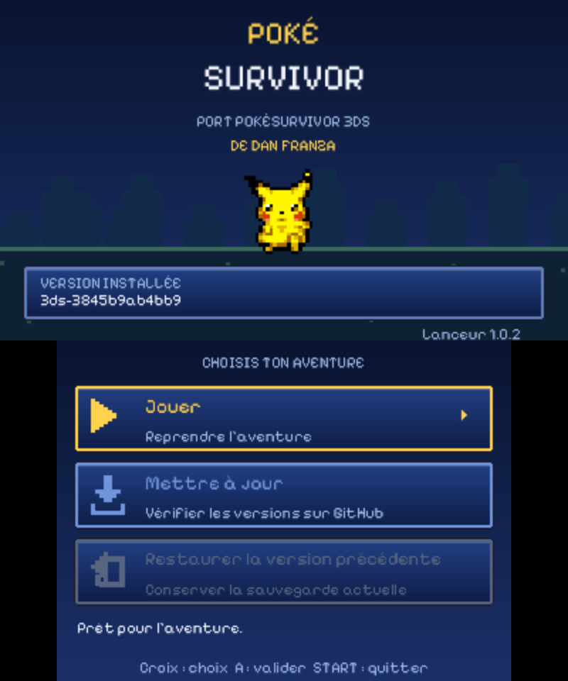
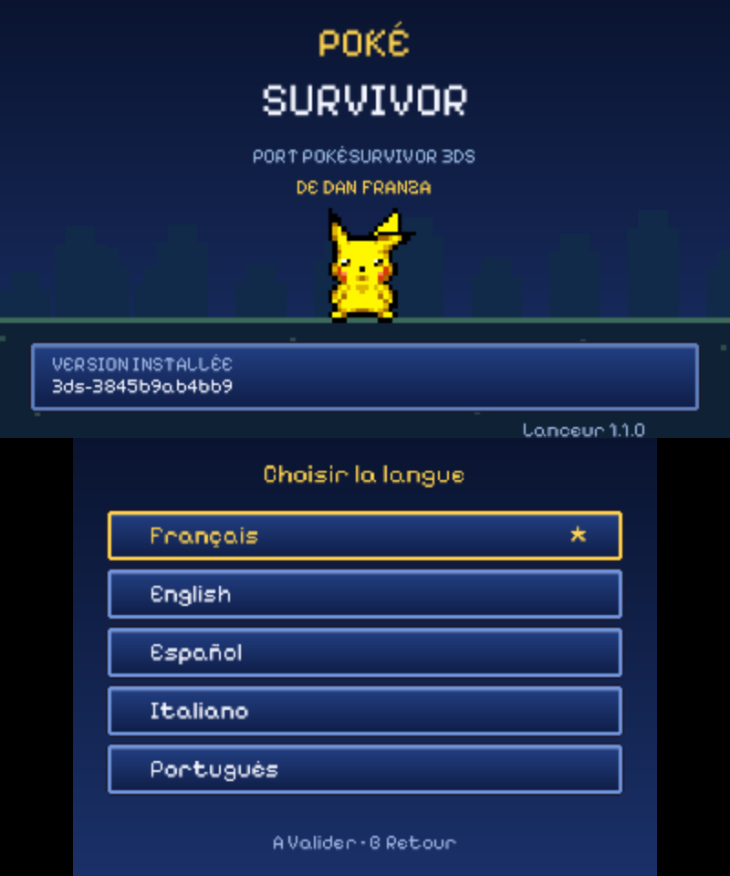

# PokéSurvivor 3DS — Dan Franza

**Launcher & Updater pour le port PokéSurvivor 3DS de Dan Franza.**

Une application indépendante pour jouer, télécharger les mises à jour et revenir
à la version précédente du portage. Disponible en **3DSX** et **CIA**, avec une
interface en cinq langues inspirée du jeu : police pixel, panneaux bleus et Pikachu animé.

Le jeu d'origine est **[PokéSurvivor de JPTER78](https://github.com/JPTER78/pokesurvivor)**.
Le portage Nintendo 3DS est maintenu par **[Dan Franza](https://github.com/DanFranza/pokesurvivor3DS/tree/port-3ds-danfranza)**.
Ce dépôt contient uniquement le lanceur et son programme de mise à jour.



## Télécharger

➡ **[Dernière version : 3DSX, CIA et paquet complet](https://github.com/DanFranza/PokeSurvivor3DSUpdaterLauncher/releases/latest)**

- `pokesurvivor-launcher.3dsx` : ouverture depuis Homebrew Launcher.
- `pokesurvivor-launcher.cia` : icône installable dans le menu HOME.
- `PokeSurvivorLauncher-1.2.1.zip` : les deux formats, les sources et les licences.

## Installer

### Version 3DSX

1. Copier `pokesurvivor-launcher.3dsx` dans `sd:/3ds/PokeSurvivorLauncher/`.
2. Ouvrir le lanceur depuis Homebrew Launcher.
3. Choisir **Installer le jeu** et confirmer le téléchargement.

### Version CIA

1. Installer `pokesurvivor-launcher.cia` avec votre installateur habituel.
2. Ouvrir l'icône **PokéSurvivor 3DS — Dan Franza** dans le menu HOME.
3. Choisir **Installer le jeu**.

**Sur console, Luma3DS est requis.** Pour démarrer le jeu 3DSX depuis le CIA,
Homebrew Launcher Loader doit aussi être installé sur la SD, ou le titre homebrew
correspondant doit être configuré dans Luma. Le lanceur vérifie ce prérequis.
Le menu **Installer / Mettre à jour** propose **3DSX** ou **CIA** pour le jeu.
Le CIA du jeu est téléchargé, vérifié et installé directement sur la console ;
il apparaît ensuite dans le menu HOME. Le bouton **Jouer** ouvre le format choisi
lors de la dernière installation réussie. Le chargeur homebrew est nécessaire
uniquement pour jouer au format 3DSX.

Le RomFS du lanceur est intégré : aucun dossier graphique supplémentaire à copier.

## Choisir la langue

Au premier démarrage, l'écran inférieur propose **Français, English, Español,
Italiano et Português**. Toucher une langue ou la sélectionner avec la croix puis A.
Le choix s'applique immédiatement et reste enregistré pour les prochains démarrages.

Pour changer ensuite, toucher la barre **Langue** en haut de l'écran inférieur,
appuyer sur **X**, ou sélectionner cette barre à la croix puis A. B ferme le menu.
Les menus, confirmations, téléchargements, erreurs et informations de version sont
traduits dans les cinq langues. Les noms des langues restent affichés dans leur
propre langue pour faciliter le choix.

Le réglage est conservé dans `sd:/3ds/PokeSurvivorLauncher/language.txt`
(`fr`, `en`, `es`, `it` ou `pt`), séparément de l'adresse de téléchargement.
Ce choix ne modifie pas la langue du jeu lui-même.



## Les trois options

| Option | Fonction |
| --- | --- |
| **Jouer** | Ouvre le jeu installé, sans exiger de connexion Internet. |
| **Mettre à jour** | Recherche le binaire publié, télécharge et vérifie le fichier, puis conserve l'ancienne version comme secours. |
| **Restaurer la version précédente** | Rétablit le secours et conserve la version quittée pour pouvoir revenir dessus. |

Si le jeu est absent, **Mettre à jour** devient **Installer le jeu**.
Navigation à la croix ou au tactile ; A valide et START quitte. Les confirmations
et l'annulation du téléchargement sont aussi accessibles au tactile.

Le 3DSX est installé à `sd:/3ds/pokesurvivor3ds.3dsx`. Le paquet CIA est conservé
à `sd:/3ds/pokesurvivor3ds.cia` et installé sur SD via le service système.
Chaque format dispose de son propre secours. Restaurer un CIA réinstalle son secours.
**La sauvegarde `sd:/3ds/pokesurvivor3ds.sav` n'est jamais modifiée par le lanceur.**
Les versions du portage peuvent la relire dans les deux sens ; une ancienne version
n'affichera pas les nouveautés récentes.

## Notification de mise à jour

Après affichage du menu, une petite requête vérifie les métadonnées du format
actif en arrière-plan. Si le binaire publié diffère de la version installée,
**« Une mise à jour est disponible. »** apparaît. Le menu reste utilisable.
La requête dispose d'un budget de trois secondes et son résultat est conservé
quinze minutes ; hors ligne, aucun message d'erreur ne bloque le démarrage.
Cette vérification nécessite une version connue, installée par le lanceur.
L'action **Mettre à jour** effectue toujours une recherche à jour.

## D'où vient le jeu ?

Le lanceur télécharge le fichier déjà publié dans le dépôt de Dan Franza :

- Dépôt : [`DanFranza/pokesurvivor3DS`](https://github.com/DanFranza/pokesurvivor3DS).
- Branche : `port-3ds-danfranza`.
- Fichier : [`3ds/distribution/pokesurvivor3ds.3dsx`](https://github.com/DanFranza/pokesurvivor3DS/blob/port-3ds-danfranza/3ds/distribution/pokesurvivor3ds.3dsx).

Aucune release du jeu ni manifeste supplémentaire n'est nécessaire. Remplacer ce
binaire dans la branche suffit pour que le lanceur détecte une nouvelle version.
Le CIA est publié au même emplacement sous le nom `pokesurvivor3ds.cia`.
La version affichée, `3ds-…` ou `cia-…`, identifie le contenu du fichier publié.

Les connexions utilisent HTTPS avec vérification des certificats. La taille et
l'identifiant de l'objet Git sont contrôlés avant l'installation ; les copies de
secours sont vérifiées avec SHA-256. Un téléchargement incomplet ou refusé laisse
le jeu actuel intact. Un journal permet de récupérer une installation interrompue,
sous réserve que la carte SD et son système de fichiers restent lisibles.

Pour un jeu de 46 Mo, prévoir environ 47 Mo libres pour le 3DSX, ou 93 Mo
pour le téléchargement et l’installation du CIA, en plus des fichiers déjà présents. Ne pas retirer la SD pendant l'installation.

## Configuration et mise à niveau du lanceur

La configuration est créée automatiquement dans
`sd:/3ds/PokeSurvivorLauncher/config.ini`. Il n'est pas nécessaire de la modifier
pour utiliser le dépôt de Dan Franza.

L'ancienne adresse erronée de la version 1.0.0 est corrigée automatiquement lors
d'une recherche de mise à jour. Une adresse personnalisée reste conservée.

Pour actualiser le **lanceur lui-même**, remplacer son 3DSX ou réinstaller son CIA.
L'option **Mettre à jour** concerne le jeu, pas le lanceur.

## Compiler et tester

Prérequis : devkitPro avec `3ds-dev`, libctru, citro2d et citro3d ; `makerom` pour CIA.
Le RomFS et la bannière nécessaires sont fournis.

```sh
./tools/build.sh
MAKEROM=/chemin/makerom ./tools/build.sh --cia
./tools/test.sh
```

Les tests sur ordinateur nécessitent un compilateur C++17 et Python 3.
Les traductions se trouvent dans `translations/launcher.tsv` (colonnes FR/EN/ES/IT/PT).
Après une modification, exécuter `python3 tools/generate_translations.py` pour
régénérer la table C++. Le build vérifie la présence des cinq traductions et la
conservation des paramètres des messages.
Voir [la documentation technique](docs/TECHNICAL.md) pour le journal de récupération,
le format de configuration, les outils et le mode de publication alternatif.

### État de validation

- Compilation des versions 3DSX et CIA.
- Interface, sélection des cinq langues et conservation du choix après redémarrage contrôlées dans Azahar 2126.2.
- Téléchargement réel de 48 334 904 octets depuis GitHub, contrôle d'intégrité et
  installation complète réussis dans Azahar.
- Tests automatisés de stockage, restauration, interruptions, transfert HTTP,
  configuration, lecture JSON et empreintes.

**À valider sur une vraie console :** installation du CIA, passage au jeu via Luma
et fonctionnement réseau sur le matériel. Azahar permet de tester le téléchargement
et l'installation ; le chargeur Luma nécessaire au bouton **Jouer** n'y est pas garanti.

## Crédits et licences

Le code du projet est distribué sous **PolyForm Noncommercial 1.0.0**, en cohérence
avec les éléments repris du jeu d'origine. Les composants tiers conservent leurs
licences propres : police SIL OFL, picojson BSD 2 clauses, bibliothèques devkitPro
et éléments SpriteCollab. Aucun droit sur les marques Pokémon n'est revendiqué.

- [Licence du projet](LICENSE)
- [Détail des licences et périmètres](LICENSES.md)
- [Crédits et provenances](NOTICE.md)
- [Historique des versions](CHANGELOG.md)

Projet de fans indépendant, sans affiliation avec Nintendo, Game Freak, Creatures
ou The Pokémon Company.
